# ROS TurtleBot3 자율주행 — SLAM · Navigation · VisionDrive

ROS Noetic과 TurtleBot3 Burger로 **LiDAR SLAM 지도 작성 → AMCL 위치 추정 → 목표 지점 자율주행**, 그리고 **카메라 차선 인식 주행과 SLAM 내비게이션을 하나로 묶은 VisionDrive**까지 직접 실행 · 튜닝하고 영상으로 기록한 개인 실습 프로젝트입니다.

<p align="center">
  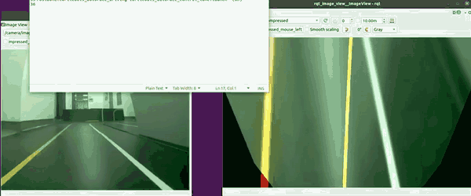
  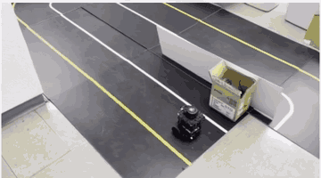
  <br><sub>VisionDrive — 왼쪽: 카메라 원본 / 차선 검출 결과(<code>/detect/image_lane</code>), 오른쪽: 실제 트랙 주행 (2배속)</sub>
</p>

| 항목 | 내용 |
| --- | --- |
| 기간 | 2026년 8월 (주행 영상 촬영 8.18) |
| 형태 | 개인 실습 프로젝트 · 과정에서 제공한 실습 장비 사용 |
| 과정 | AI 스마트 제조 융합 인재양성과정 · 대한상공회의소 부산인력개발원 |
| 로봇 | TurtleBot3 Burger — Raspberry Pi SBC, OpenCR(STM32F7), 360° LiDAR(LDS), DYNAMIXEL XL430, RPi 카메라(160° 어안) |
| 소프트웨어 | Ubuntu 20.04 · ROS Noetic · Gmapping · AMCL · move_base(NavFn + DWA) · turtlebot3_autorace · RViz · rqt |
| 결과물 | 제출 영상 2편(SLAM & Navigation 10분 42초, VisionDrive 8분 20초) + 실제 주행 촬영 3편 |

## 한눈에 보기

| | SLAM & Navigation | VisionDrive |
| --- | --- | --- |
| 목표 | 복도 지도를 만들고, 그 지도 위에서 목표 지점까지 자율 이동 | 카메라로 차선을 따라 달리고, LiDAR 지도 기반 내비게이션까지 통합 |
| 센서 | LiDAR, IMU · 엔코더(오도메트리) | 어안 카메라 + LiDAR |
| 핵심 노드 | `slam_gmapping` → `map_saver` → `amcl` · `move_base` | `image_projection` → `detect_lane` → `control_lane` + `move_base` |
| 확인 방법 | RViz 파티클 · 코스트맵, `rqt` Topic Monitor | `rqt_image_view`, `rqt_graph` 노드 구조 |

---

## 1. TurtleBot3 SLAM & Navigation — Gmapping · AMCL

키보드로 로봇을 몰며 Gmapping으로 복도 지도를 만들고, 저장한 지도 위에서 AMCL로 위치를 잡은 뒤 목표 지점을 찍어 자율 주행시켰습니다.

| 지도 작성 (Gmapping, 6배속) | 자율 주행 (AMCL + move_base, 10배속) |
| --- | --- |
| 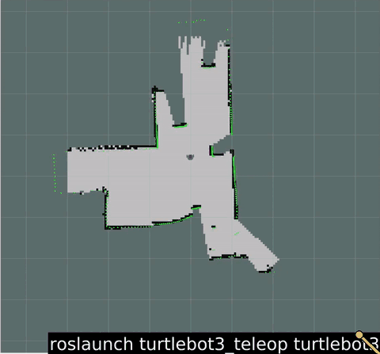 | 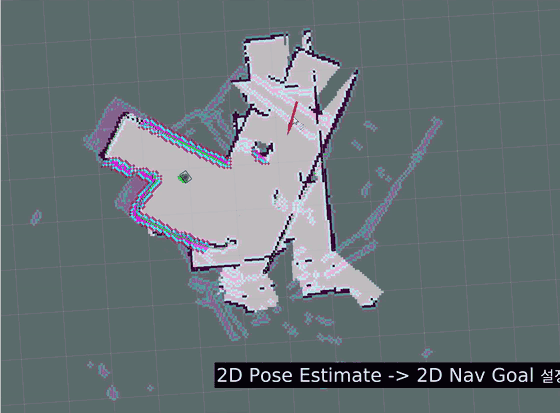 |

### 진행 순서

```text
roscore (Remote PC)
 └─ turtlebot3_robot.launch        (SBC: OpenCR · LiDAR 브링업)
     └─ turtlebot3_slam.launch     (Gmapping 시작)
         └─ turtlebot3_teleop_key  (키보드로 이동하며 지도 작성)
             └─ map_saver -f ~/map (map.pgm + map.yaml 저장)
                 └─ turtlebot3_navigation.launch map_file:=$HOME/map.yaml
                     ├─ 2D Pose Estimate  → AMCL 초기 위치 지정
                     └─ 2D Nav Goal       → move_base 경로 계획 · 주행
```

### 확인한 것

- **지도 작성**: 텔레옵으로 천천히(선속도 약 0.02 m/s) 이동하며 스캔 매칭 로그(`Average Scan Matching Score`, `neff`)를 함께 보고 복도 형상이 닫히는지 확인
- **위치 추정**: `2D Pose Estimate` 직후 넓게 퍼져 있던 AMCL 파티클(`/particlecloud`)이 주행하면서 로봇 주변으로 모이는 과정 관찰
- **경로 계획**: 전역 경로(NavFn)와 지역 경로(DWA), 장애물 주변으로 부풀려진 inflation 코스트맵을 RViz에서 확인
- **토픽 점검**: `rqt` Topic Monitor로 `/scan`, `/odom`, `/amcl_pose`, `/move_base/*`, `/camera/image/compressed` 등 실제 발행 토픽과 메시지 타입 확인

| 저장한 지도 | 내비게이션 화면 |
| --- | --- |
| 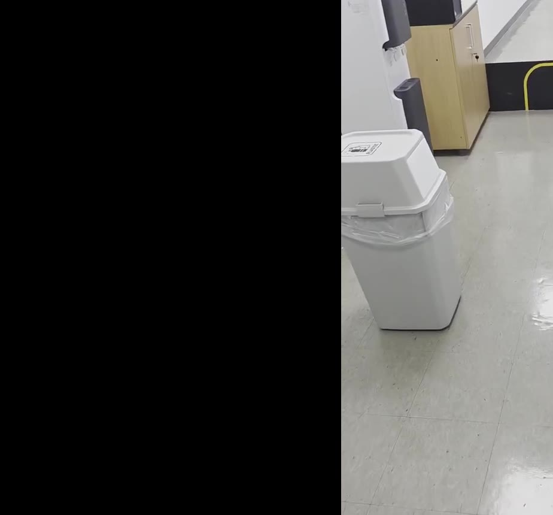 | 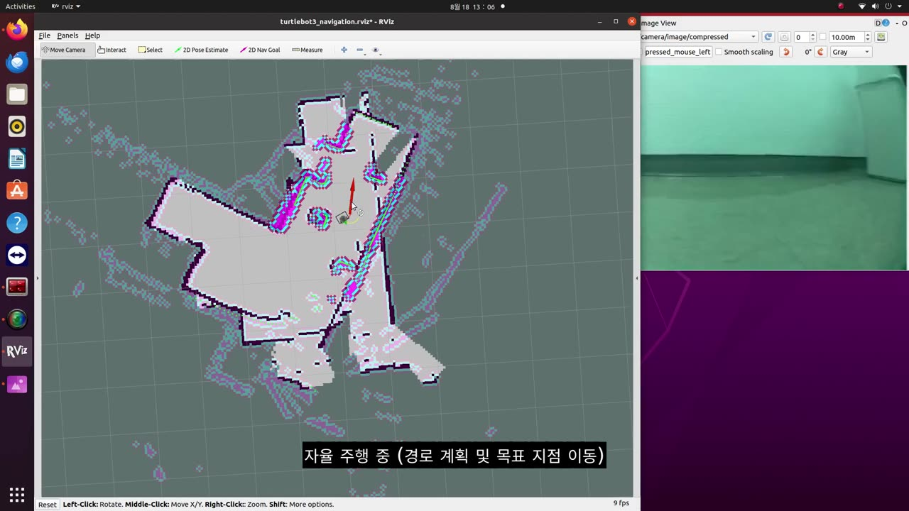 |

---

## 2. VisionDrive — 카메라 차선 인식 + LiDAR SLAM 내비게이션

어안 카메라로 노란선 · 흰선을 검출해 차선을 따라 주행하고, 같은 트랙을 LiDAR로 매핑한 뒤 내비게이션과 차선 주행을 함께 켜서 달리게 한 프로젝트입니다.

### 파이프라인

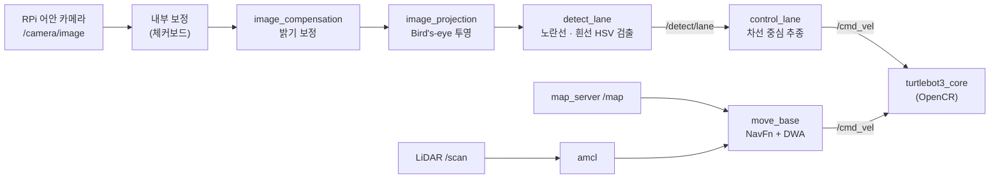

### 진행 순서

1. **카메라 노드 실행** — `raspberry_pi_camera_publish.launch`
2. **내부 보정(Intrinsic)** — 체커보드로 어안 렌즈 왜곡 보정, `rqt_reconfigure`로 밝기 · 대비 조정 후 `camera.yaml` 반영
3. **외부 보정(Extrinsic)** — 바닥을 위에서 본 시점(Bird's-eye view)으로 투영할 영역을 잡고 `projection.yaml` 반영
4. **차선 검출** — 노란선 · 흰선의 HSV 범위를 `rqt_reconfigure`로 맞추며 `/detect/image_lane` 결과 확인 → `lane.yaml` 저장
5. **차선 주행** — `turtlebot3_autorace_control_lane.launch`로 검출한 차선 중심을 따라 주행
6. **트랙 매핑** — 차선 제어를 끄고 `turtlebot3_slam.launch` + `map_saver`로 트랙 지도 저장
7. **통합 주행** — `turtlebot3_navigation.launch` 위에 차선 제어를 다시 켜고 목표 지점까지 주행

| 차선 검출 | 트랙 SLAM | 내비게이션 + 차선 |
| --- | --- | --- |
| 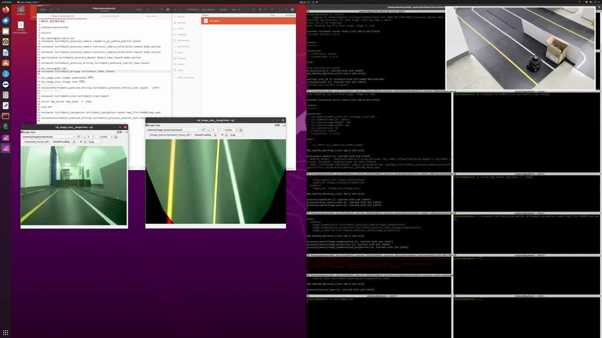 | 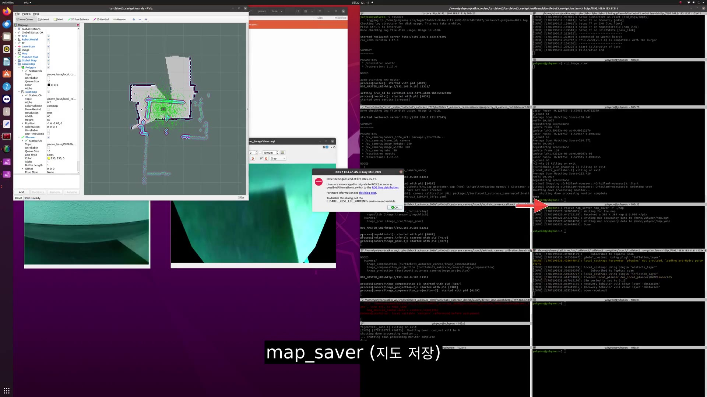 | 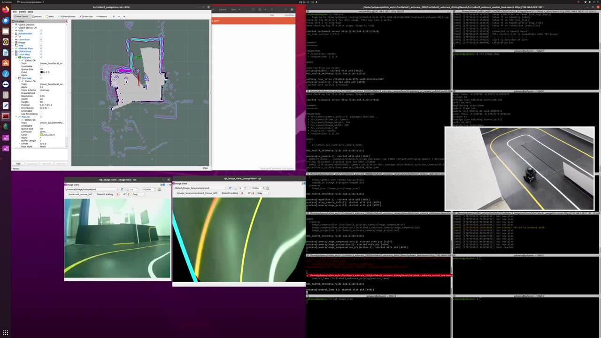 |

### 노드 구조 (`rqt_graph`)

<p align="center">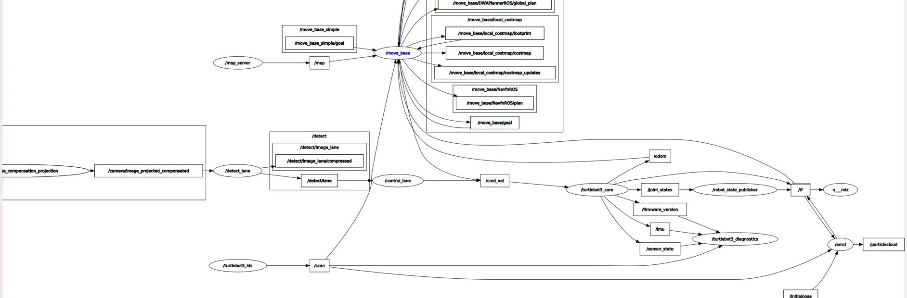</p>

투영된 영상(`/camera/image_projected_compensated`) → `/detect_lane` → `/control_lane` → `/cmd_vel` → `/turtlebot3_core`로 이어지는 비전 경로와, `/scan` · `/map` → `/amcl` · `/move_base` → `/cmd_vel`로 이어지는 내비게이션 경로가 한 그래프에 함께 있습니다.

### 주행 로그에서 본 것

```text
[INFO] Got new plan            ← 약 0.2초 간격으로 전역 경로 재계획
[WARN] DWA planner failed to produce path.
[INFO] Got new plan            ← 곧바로 재계획 후 주행 계속
[INFO] Goal reached
```

지역 플래너가 한 번 경로를 못 만들었지만 전역 경로 재계획으로 이어서 목표에 도달했습니다.

---

## 실제 주행 영상

썸네일을 누르면 영상 파일이 열립니다.

| | | |
| --- | --- | --- |
| [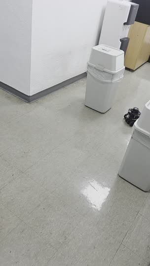](media/real_robot.mp4)<br>**복도 자율 주행** (3배속) | [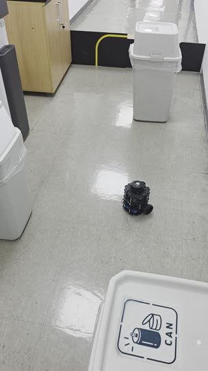](media/real_robot2.mp4)<br>**장애물 사이 주행** (22초) | [](media/visiondrive_lane.mp4)<br>**차선 주행 하이라이트** (40초) |

**제출 영상 전체 (720p 압축본)**

- [SLAM & Navigation — Gmapping & AMCL Localization Analysis (10:42)](media/SLAM_Navigation_full_720p.mp4) · [5배속 요약](media/slam_nav_5x.mp4)
- [VisionDrive — Camera Lane Detection and LiDAR SLAM Navigation (8:20)](media/VisionDrive_full_720p.mp4) · [내비게이션 구간](media/visiondrive_nav.mp4)

---

## 돌아보며 — 개선할 점

| 관찰 | 생각한 개선 방향 |
| --- | --- |
| `rqt_graph`에서 `control_lane`과 `move_base`가 **같은 `/cmd_vel`에 동시에 발행**하는 구조 | 두 명령이 섞이지 않도록 `twist_mux` 같은 우선순위 선택기나 상황별 모드 전환을 두는 편이 안전 |
| 차선 검출 결과가 조명 · 반사에 따라 흔들림 (영상 색감이 녹색으로 치우친 구간 존재) | 밝기 보정 값과 HSV 범위를 조명 조건별로 따로 저장하고, 검출 실패 시 감속 · 정지 규칙 추가 |
| DWA 경로 생성 실패 경고가 간헐적으로 발생 | 좁은 통로에서 inflation 반경 · 로봇 footprint · DWA 속도 샘플 수를 조정해 비교해 볼 것 |

## 이 프로젝트에서 다룬 것

| 주제 | 내용 |
| --- | --- |
| ROS 기본기 | 패키지 · 노드 · 토픽 · launch, catkin 빌드, Remote PC ↔ SBC 네트워크(`ROS_MASTER_URI`) 구성 |
| SLAM | LiDAR 기반 Gmapping으로 지도 작성, `map_server`로 저장 · 불러오기 |
| 위치 추정 | 파티클 필터 기반 AMCL, 초기 위치 지정과 파티클 수렴 |
| 경로 계획 | 전역(NavFn) · 지역(DWA) 플래너, global / local 코스트맵, inflation |
| 비전 | 어안 카메라 내부 · 외부 보정, Bird's-eye 투영, HSV 차선 검출, 차선 중심 추종 |
| 디버깅 도구 | RViz, `rqt_image_view`, `rqt_reconfigure`, `rqt_graph`, Topic Monitor |

더 자세한 실행 명령은 [`docs/run_commands.md`](docs/run_commands.md), 개념 정리는 [`docs/concepts.md`](docs/concepts.md)에 있습니다.

> 과정 강의 교재(PDF)는 저작권 때문에 이 저장소에 넣지 않았습니다. 영상은 원본(1080p)을 720p로 압축한 것입니다.
